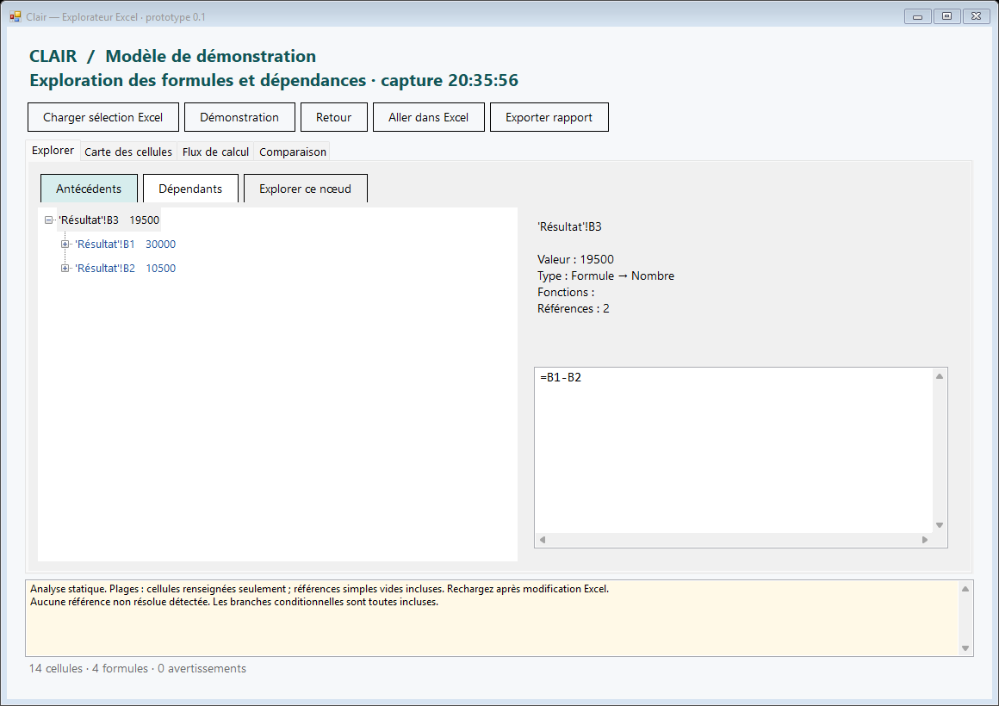

# Clair — Explorateur Excel

Prototype Windows indépendant pour explorer les formules et les dépendances d'un classeur Excel. C# / .NET Framework 4.8, interface WinForms, licence GNU.



## État

La version 0.6 fournit une application autonome et un complément Excel avec ruban, carte et flux colorés sur la grille, arbre de blocs par feuille, couleurs réversibles et palettes persistantes. La reconstruction reste en cours : l'identité fonctionnelle et visuelle avec Arixcel n'est pas établie. Le [registre de parité](docs/PARITY.md) décrit les exigences et les preuves manquantes. Aucun composant, code décompilé, visuel ou ressource Arixcel n'est distribué avec le projet.

Le chargement COM, le callback du ruban, l'ouverture de plusieurs explorateurs et leur fermeture sont validés localement dans Excel 16.0. Les autres versions et l'architecture 32 bits restent à tester.

Les travaux suivants remplacent les couleurs CF par des formats directs partagés entre cartes et flux, ajoutent retrait/permanence globaux et sauvegarde d'un historique propre à Clair. Leur [validation](docs/VALIDATION.md) reste distincte de la livraison 0.6 ; l'équivalence complète avec Arixcel n'est pas établie. L'historique enregistré décrit base et sommet de chaque propriété, sans recréer les fenêtres d'analyse. Après fermeture de l'application autonome, les modifications structurelles ultérieures ne sont plus suivies ; le complément chargé conserve ce suivi. Les cartes masquent temporairement les fonds des règles CF admissibles de toute leur feuille. Un journal séparé conserve leurs neuf propriétés de fond pour les restaurer, y compris après sauvegarde/réouverture ; conserver les couleurs directes restaure aussi les fonds CF. Les familles non couvertes et les conflits sont détaillés dans la validation.

## Fonctions disponibles

- Capture du classeur actif et de la cellule sélectionnée, avec lecture groupée des valeurs et formules.
- Arbre d'antécédents et de dépendants, entre feuilles et entre classeurs ouverts dans la même instance Excel, avec détection des cycles et historique de navigation. Le volet peut proposer d'ouvrir un classeur fermé quand la référence sélectionnée contient son chemin. Les références non résolues signalent une recherche partielle.
- Décomposition syntaxique des formules en fonctions, arguments, opérateurs, références et matrices. Le curseur retrouve son composant dans l'arbre. Ctrl et Maj permettent de sélectionner plusieurs composants, soulignés dans le texte et surlignés dans Excel quand leurs plages sont résolues.
- Navigation vers les feuilles masquées ou très masquées, avec dévoilement des lignes et colonnes activé par défaut. **Remasquer** rétablit la visibilité d'origine. Clair annule l'enregistrement si Excel refuse la restauration du masquage temporaire.
- **Ctrl+flèches** parcourt les coins et les zones Excel. **Alt+S** rétablit la sélection complète et **Alt+Z** déplie ou replie la branche. **Ctrl+Q** et **Ctrl+Maj+Q** relancent le tracé en amont ou en aval. **Alt+R** actualise le tracé depuis ses cellules sources et retrouve les branches et sélections qui existent encore. **Analyser** démarre un tracé depuis la sélection Excel courante.
- Dans le volet **Formule**, **Entrée** et **Échap** ferment le tracé courant. Le tracé parent revient dans le même volet s’il existe. Par défaut, la sélection Excel reste en place. Dans **Options**, **Échap revient à la sélection précédente** rétablit la sélection de lancement ou du parent. Pendant l’édition, **Entrée** valide et **Échap** annule.
- Évaluation des sous-expressions par Excel dans le contexte de la cellule : fonctions anglaises indépendantes de la langue Windows, variables LET, noms relatifs, références structurées de la ligne courante. La sélection Excel est restaurée après calcul.
- Saisie directe et F2 dans le volet pour les formules, les constantes et l’effacement. L’édition d’une formule matricielle CSE porte sur son bloc entier. Le tracé et son historique restent accessibles après validation ou annulation.
- Références A1 absolues/relatives, plages rectangulaires, lignes/colonnes entières, noms absolus, intersections de références directes et noms de feuilles contenant des apostrophes.
- Navigation vers une cellule dans Excel, sans modifier sa valeur ou son format.
- Carte structurelle : formules uniques, copies vers le bas/la droite/deux directions, références locales/interfeuilles/externes, constantes et validation. Les formules sont comparées en notation R1C1 aux voisins immédiats haut et gauche.
- Coloration de la grille Excel sur une ou toutes les feuilles ; retrait après sauvegarde/réouverture. Palette de fond et police, catégories activables, import/export XML et réglage par défaut enregistré explicitement.
- Parcours transitif en amont et en aval d'une cellule.
- Analyse des rôles de calcul et des flux de frontière avec périmètre et zone centrale distincts : entrées, calculs, sorties, formules isolées et quatre rôles de frontière.
- Flux regroupés en blocs rectangulaires selon le rôle et les formules R1C1, activables par groupe, bloc ou cellule, avec états mixtes. Fond et police indépendants se combinent sur les cellules portant deux rôles. Chaque fenêtre possède sa couche de couleurs, retirée à sa fermeture ou conservée explicitement pour un retrait ultérieur.
- Arbre de flux par catégorie ou par feuille, ordre des feuilles Excel et émission des blocs conservés, réglages distincts pour les deux vues, navigation clavier et sélection synchronisée avec la grille.
- Comparaison de deux captures : formules et constantes, ou valeurs calculées avec tolérance numérique absolue.
- Rapport texte local et démonstration intégrée sans Excel.

## Démarrage

Prérequis : Windows, .NET Framework 4.8, Excel de bureau pour la connexion aux classeurs. Aucun paquet NuGet ni SDK .NET supplémentaire n'est nécessaire pour la compilation sur un système disposant du compilateur .NET Framework.

Depuis PowerShell, dans le dossier du projet :

```powershell
.\build.ps1
.\bin\Clair.exe
```

L'application démarre avec un modèle de démonstration. Pour votre classeur :

1. Ouvrez Excel, le classeur et la cellule à explorer.
2. Dans Clair, cliquez sur **Charger sélection Excel**.
3. Dépliez l'arbre d'antécédents, ou choisissez **Dépendants**.
4. Double-cliquez sur un nœud pour naviguer vers Excel. **Explorer ce nœud** change la racine de l'analyse.
5. Rechargez la sélection après une modification du classeur : l'analyse utilise une capture, pas une synchronisation permanente.

Dépliez les sous-expressions pour repérer leur texte et les évaluer dans Excel. Décochez **Évaluer au clic** pour travailler manuellement. Tapez ou collez dans le champ, ou utilisez **F2** ou **Modifier**. **Entrée** applique, **Alt+Entrée** insère un saut de ligne et **Échap** abandonne la saisie. Le champ vide efface le contenu. Excel interprète les valeurs et les formules selon le format de la cellule, avec des fonctions en anglais. Dans un tableau structuré, l’édition reste limitée à la cellule. Pour une matrice CSE, elle couvre tout le bloc dans la limite de 255 caractères. **Ctrl+Z** agit sur le brouillon pendant la saisie et sur la dernière édition Clair hors saisie. Clair contrôle les modifications intervenues entre-temps et restaure le contenu typé et le format numérique généré par l’édition.

Dans **Flux de calcul**, choisissez un périmètre, une zone centrale puis **Analyser**. Clair actualise le même classeur et calcule les rôles. Une première analyse démarre sans couleurs ; cochez les groupes ou blocs à colorer. Une nouvelle analyse conserve les choix des cellules qui portent encore le même rôle ; les nouveaux rôles restent décochés. Le périmètre classeur/feuille utilise les cellules capturées ; une sélection Excel inclut aussi ses cellules vides. Le menu des vues distingue rôles de calcul et flux traversant la zone centrale. Un avertissement de dépendance rend ces résultats partiels.

À gauche, l'arbre permet d'activer tous les descendants d'une catégorie, d'une feuille ou d'un bloc ; sa racine concerne toute la vue. **Regrouper par feuille** inverse les niveaux feuille/catégorie dans la vue des rôles. Dans la vue frontière, il affiche les feuilles extérieures et conserve la feuille centrale implicite. Le choix est indépendant pour chaque vue et enregistré dans `%LOCALAPPDATA%\Clair\flow-view.xml`. Les feuilles suivent l'ordre Excel ; les rectangles restent dans leur ordre d'émission, sans tri par adresse.

Dans l'arbre, **Espace** bascule les couleurs du nœud sélectionné et **Entrée** explore la première cellule d'un bloc ; les flèches développent ou replient les branches. La sélection d'un bloc suit celle de la grille et reste retrouvable lors d'un changement de regroupement. Les comptes des parents et les infobulles indiquent rôles actifs et blocs.

Les cases de la grille activent aussi un bloc rectangulaire pour un rôle. **Détail par cellule** permet un choix plus fin, conservé en revenant aux blocs : un bloc partiellement sélectionné affiche un état mixte, et le cocher active tous ses membres. Une cellule peut apparaître deux fois dans la vue de frontière : par exemple, sa police verte indique une entrée tandis que son fond bleu indique une sortie. Pour deux couleurs personnalisées portant sur la même propriété, la dernière activation concernant cette cellule passe au-dessus. **Palette flux…** règle les deux propriétés et peut enregistrer `%LOCALAPPDATA%\Clair\flow-palette.xml` pour les prochaines fenêtres.

Fermer une fenêtre retire ses propres couleurs de flux dans les classeurs encore ouverts. **Fermer en conservant** les laisse présentes ; rechargez ensuite le classeur et utilisez **Retirer tous les flux** pour retirer toutes les couches de flux Clair du classeur courant. La carte reste indépendante. Cette conservation temporaire ne reproduit pas encore la commande Arixcel qui rend les couleurs permanentes en abandonnant l'historique sous-jacent. Si le classeur ou Excel est déjà fermé, le nettoyage ne modifie aucun fichier fermé : les couleurs enregistrées restent retirables après réouverture.

Dans **Carte des cellules**, choisissez une feuille ou **Toutes les feuilles**, puis **Colorer dans Excel**. Clair recapture le même classeur avant de classer les cellules. **Retirer couleurs** supprime uniquement ses règles de carte ; les couleurs restent présentes tant que cette commande n'est pas utilisée, y compris après fermeture de Clair et sauvegarde du classeur. Après réouverture, rechargez le classeur dans Clair pour les retirer. Les feuilles protégées sont refusées avant toute modification.

Dans l'archive 0.6, **Palette…** règle les catégories et couleurs. **Aucun** laisse la propriété existante visible. **Utiliser** change la palette de cette fenêtre pour le prochain clic **Colorer dans Excel**. **Enregistrer par défaut** la conserve dans `%LOCALAPPDATA%\Clair\map-palette.xml`. Le XML importé/exporté utilise le format Clair. **Rapport carte** exporte toutes les catégories et les avertissements de la capture.

Sur la branche de développement en brouillon, **Carte → Palette…** affiche les couleurs dans le volet latéral. Chaque modification s'applique aux cartes actives et s'enregistre pour les prochaines sessions. Désactiver **Analyser les formules uniques** regroupe leurs sous-types tout en gardant les directions de copie. Un style de validation actif déclenche son analyse. **Plus…** permet de rétablir les couleurs d'origine et d'échanger des profils JSON Arixcel. Pour conserver aussi les polices et les catégories propres à Clair, utilisez le format XML Clair. [Registre de parité](docs/PARITY.md)

Pour ajouter le ruban à Excel :

```powershell
.\build.ps1 -WithExcelShortcut
.\install-addin.ps1
# Ouvrir ensuite une nouvelle instance d'Excel.
# Pour désinstaller : .\install-addin.ps1 -Uninstall
```

`-WithExcelShortcut` compile le XLL natif pour Excel 32 et 64 bits avec Visual Studio Build Tools, les outils MSVC x86/x64 et le SDK Windows. L'archive Windows de CI contient les deux fichiers. Ils se placent dans `bin` à côté de `Clair.AddIn.dll`.

Sur la branche de développement, **Clair → Antécédents** ouvre le volet **Formule**, ancré à droite de la feuille. **Dépendants** change le sens dans le même volet. Les onglets **Carte**, **Flux** et **Comparer** donnent accès aux autres analyses. Le bouton principal **Carte des cellules** bascule les couleurs sur la grille. Sa flèche donne accès à **Ouvrir le volet Carte** et **Couleurs de carte**. Redimensionnez le volet à la souris ou fermez-le avec sa croix pour retrouver toute la largeur de la feuille.

Dans **Formule**, Clair met en gras l'argument retenu par `IF`, `IFS`, `CHOOSE`, `SWITCH`, `IFERROR` ou `IFNA` quand Excel fournit les valeurs nécessaires. `FILTER` et `XLOOKUP` peuvent aussi marquer leur valeur de secours. Tous les arguments restent consultables. **Évaluer** actualise ce repère quand l'évaluation au clic est désactivée. Le graphe des références continue de couvrir toute la formule.

Pour `INDEX`, `OFFSET`, `INDIRECT` et les recherches prises en charge, l'arbre affiche l'adresse effectivement trouvée devant la fonction. `MATCH` et `XMATCH` affichent toujours leur résultat numérique dans l'aperçu. Utilisez **Aller à la cible dans Excel** dans le menu contextuel pour recalculer et sélectionner la plage.

Pour `SUMIF`, `COUNTIF`, `AVERAGEIF` et leurs variantes à plusieurs critères, le volet affiche les zones retenues. Les groupes **Filtre** montrent les cellules de chaque critère et gardent la plage et le critère consultables. `FILTER` distingue la plage renvoyée de la source d'un masque issu d'une comparaison directe. `MIN`, `MAX`, `MINA`, `MAXA`, `MINIFS`, `MAXIFS`, `SMALL`, `LARGE` et certains modes de `SUBTOTAL` et `AGGREGATE` peuvent pointer vers la cellule du résultat. L'aperçu de la formule affiche la valeur calculée par Excel. [Validation](docs/VALIDATION.md)

`MIN`, `MAX`, `MINA`, `MAXA`, ainsi que `SUBTOTAL` et `AGGREGATE` en modes 4 et 5, mettent en gras le premier argument qui correspond au résultat. Une plage peut être en gras pendant que la fonction affiche l'adresse de la cellule correspondante. [Validation des arguments retenus](docs/VALIDATION.md)

Une référence 3D comme `Jan:Mar!B2` se développe par feuille dans **Formule**. L'aperçu calcule le résultat de l'argument seul pour les agrégats pris en charge. Pour un extrémum, le gras distingue aussi la première feuille qui correspond au résultat. Le menu contextuel de chaque feuille permet d'ouvrir sa plage. Les feuilles masquées restent consultables dans l'arbre et doivent être affichées dans Excel pour y naviguer. [Validation des références 3D](docs/VALIDATION.md)

**Antécédents**, **Dépendants** et **Flux** suivent les plages 3D du classeur capturé. Ils incluent les feuilles intermédiaires et les cellules référencées par les arguments écartés au calcul. Le Flux limite ces liens à son périmètre.

Sélectionnez plusieurs cellules dans Excel, même disjointes, puis cliquez sur **Antécédents** ou **Dépendants** dans le ruban Clair. L'arbre occupe la majorité du volet et compte les plages de résultat. **Grouper par feuille** affiche leurs sous-totaux.

Dans l'arbre, **Ctrl+clic** ajoute ou retire un résultat et **Maj+clic** sélectionne un intervalle de lignes visibles. Dans le volet Excel, la grille suit la sélection et combine les plages de la feuille du résultat courant. **Voir cellule** permet aussi de rejoindre explicitement cette sélection. **Ctrl+Q** trace les antécédents de toutes les plages retenues et **Ctrl+Maj+Q** leurs dépendants. La vue **Sélection multiple** sépare les sources et les résultats, avec leurs compteurs. **Retour** retrouve les sources, les résultats sélectionnés et la ligne active. [Validation](docs/VALIDATION.md)

**Surligner dans Excel** affiche les sources en rose, les antécédents sélectionnés en bleu et les dépendants sélectionnés en vert, y compris sur plusieurs feuilles. Chaque tracé de l'historique conserve sa propre couche. **Retour** retire la couche du tracé quitté. Désactiver la case ou fermer le volet retire les couches de trace. Elles partagent les fonds directs de Carte et Flux. [Validation](docs/VALIDATION.md)

Chaque fenêtre de classeur possède son propre volet. **Tout fermer** ferme les volets de la session Excel. L'installation concerne le compte Windows courant et conserve le chemin de ce dossier. Après une mise à jour depuis l'archive 0.6, relancez `install-addin.ps1` pour enregistrer aussi le contrôle du volet, puis ouvrez une nouvelle instance d'Excel.

Avec le XLL chargé, **Ctrl+Retour arrière** rend le focus à la grille depuis le volet **Formule** et garde le tracé ouvert. Depuis la grille, le raccourci réactive et actualise un tracé encore ouvert ou restaure une sélection de lancement. L'historique garde jusqu'à 100 entrées dans cette instance Excel. Quand Arixcel est déjà connecté dans l'instance, Clair lui laisse la touche.

Pour comparer : chargez le premier état, ouvrez **Comparaison**, puis **Mémoriser référence**. Modifiez le classeur ou activez un autre classeur dans Excel, puis cliquez sur **Comparer classeur Excel actif**. Les cellules sont appariées par nom de feuille et adresse. En mode formules, un changement de résultat calculé seul n'est pas une différence ; activez **Valeurs calculées** pour le comparer.

Si plusieurs instances Excel sont ouvertes, la connexion autonome utilise celle exposée par `GetActiveObject`. Le nom du classeur capturé est affiché en haut. Les noms de classeurs non enregistrés ne constituent pas une identité durable entre plusieurs instances.

## Tests

```powershell
.\test.ps1          # moteur, syntaxe, flux, carte et palette (sans Excel)
.\test.ps1 -WithExcelShortcut  # build et test du pont natif
.\test.ps1 -Excel   # sessions Excel isolées, expressions, édition, couleurs et restauration
.\test-addin.ps1    # démarrage Excel /x, ruban, volet natif et nettoyage du registre
```

Le test Excel crée des instances et classeurs jetables. Il vérifie aussi les évaluations en français/anglais, les noms et tableaux, les sélections de plages/formes, l'édition, l'annulation, les conflits et les formats. Le test de couleurs enregistre une copie temporaire, la rouvre, retire la carte et contrôle les formats effectifs, l'ordre relatif et `StopIfTrue` des règles préexistantes ; le fichier est ensuite supprimé. Le test COM installe temporairement les clés propres à Clair, lance son propre processus Excel identifié, vérifie le chargement puis supprime les clés. Il refuse de remplacer une installation Clair existante.

## Limites explicites de la version 0.6

- Le graphe de cellules utilise toujours une extraction lexicale distincte du nouvel arbre syntaxique. Toutes les branches conditionnelles y sont considérées ; l'évaluation d'une expression ne corrige pas automatiquement ce graphe.
- `INDIRECT`, `OFFSET`, `LET`, `LAMBDA`, références externes, tables structurées, noms relatifs et plages déversées signalés comme incomplets ou non résolus. Les références 3D requièrent deux feuilles résolues et un ordre capturé. Un avertissement signifie que le graphe peut manquer des cellules ou en inclure trop.
- Intersections directes de références prises en charge. Les intersections impliquant des noms ou expressions plus complexes nécessitent encore un analyseur syntaxique complet.
- L'arbre syntaxique prend en charge la notation A1 invariante. Notation R1C1, DDE et paramètres LAMBDA non liés ne sont pas évalués. Excel Evaluate limite l'expression contextualisée à 255 caractères ; les tableaux affichent un aperçu de 10 lignes × 5 colonnes, jusqu'à 8 zones. Les fonctions volatiles sont recalculées lors de l'évaluation.
- Édition des cellules fusionnées et matrices CSE refusée. Une formule déversée s'édite uniquement à son origine. L'annulation propre à Clair est limitée à la session de sa fenêtre ; l'historique natif d'Excel n'est pas préservé par les écritures COM.
- Les plages sont représentées par leurs cellules renseignées. Une référence simple vers une cellule vide reste visible ; les cellules vides d'une grande plage ne sont pas énumérées.
- Carte : cellules capturées renseignées ou avec validation ; les autres cellules vides restent inchangées. Classification `Indéterminée` en cas d'informations insuffisantes, désactivée dans la palette initiale. La désactivation des analyses uniques/validation d'Arixcel n'est pas reproduite : désactiver une catégorie Clair exclut seulement sa couleur.
- Couleurs par règles conditionnelles propres à Clair : formats directs et règles préexistantes conservés. L'ordre relatif des règles est conservé ; Excel peut laisser des trous dans leurs numéros de priorité. Le retrait restaure leur effet, sans promettre une identité binaire du fichier. Les écritures de formatage affectent l'historique natif d'Excel. Si Excel interrompt une transaction et empêche sa restauration, Clair signale explicitement l'échec.
- Flux : géométrie et arbre reconstruits depuis les chemins statiques observés. Six blocs 3D ont été comparés dans Excel. Les formules sans R1C1 disponible restent séparées. L'ordre interne de blocs émis dans un même lot de collections originales n'est pas établi. Les libellés R1C1, périmètres multi-classeurs, commandes globales de couleurs, permanence, progression et annulation restent à reconstruire. Les rôles analytiques restent issus du graphe lexical. Comparaison sans surbrillance, formats, alignement de lignes/colonnes ou renommage automatique des feuilles.
- Lecture des valeurs telles qu'Excel les expose. Mode de calcul manuel ou calcul en cours signalé ; aucune recalculation forcée.
- Lecture limitée à 250 000 cellules dans les zones utilisées. Arbre d'exploration : 500 relations par nœud, profondeur 32. Parcours transitif : 2 000 cellules. Listes de carte/flux : 20 000 lignes affichées ; arbre de flux : 20 000 nœuds visibles. Coloration des groupes et rapports utilisent l'analyse complète. Limites signalées lors de leur atteinte.
- Capture et analyse synchrones ; de gros modèles peuvent bloquer temporairement l'interface.
- Windows/Excel uniquement. Chargement validé dans Excel local 16.0 ; couverture d'autres versions, architectures et déploiement signé encore manquante.

## Structure

`src/Core.cs` contient le modèle, la lecture lexicale des références, les parcours et la comparaison. `FormulaSyntax.cs` construit l'arbre d'expressions ; `FlowAnalysis.cs` classe les flux, `FlowBlocks.cs` regroupe leurs rectangles, `FlowTree.cs` construit leur hiérarchie et `FlowHighlightPlan.cs` compose leurs couleurs ; `FormulaMap.cs` classe la carte. `HighlightPalette.cs`, `FlowPalette.cs`, `PaletteStorage.cs` et `FlowViewSettings.cs` conservent les réglages. `ExcelBridge.cs`, `ExcelOperations.cs` et `ExcelHighlights.cs` encapsulent les échanges COM. `MainForm.cs`, `ExpressionPanel.cs`, `FlowPanel.cs`, `FlowTreePanel.cs`, `MapPanel.cs` et `PaletteEditor.cs` fournissent l'interface. `AddIn.cs` expose le complément COM. Les tests se trouvent dans `tests/`.

Voir [analyse du logiciel de référence](docs/ANALYSIS.md), [revue et validation](docs/VALIDATION.md) et [prochaines étapes](docs/ROADMAP.md).

## Licence

[GNU](LICENSE). Arixcel et Microsoft Excel sont des produits distincts ; le projet n'est ni affilié ni approuvé par leurs éditeurs. La licence couvre uniquement les fichiers originaux de ce dépôt.
