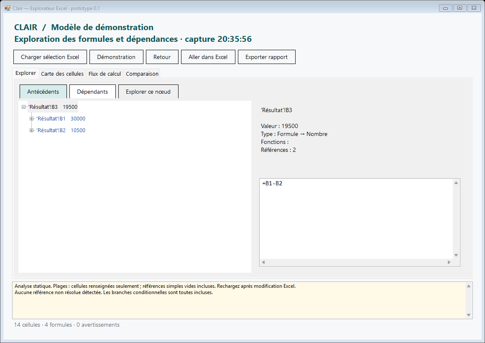

# Clair — Explorateur Excel

Prototype Windows indépendant pour explorer les formules et les dépendances d'un classeur Excel. C# / .NET Framework 4.8, interface WinForms, licence MIT.



## État

La version 0.1 fournit une application autonome connectée à Excel. Elle constitue un premier équivalent fonctionnel partiel d'outils d'audit comme Arixcel, et ne revendique pas leur couverture complète. Aucun composant, code décompilé, visuel ou ressource Arixcel n'est distribué avec le projet.

Le code du complément COM et son installateur sont également fournis, mais son chargement dans Excel reste expérimental : le test d'enregistrement local n'aboutit pas encore à une entrée dans `COMAddIns`. Utilisez l'application autonome pour cette version.

## Fonctions disponibles

- Capture du classeur actif et de la cellule sélectionnée, avec lecture groupée des valeurs et formules.
- Arbre d'antécédents et de dépendants, entre feuilles, avec détection des cycles et historique de navigation.
- Références A1 absolues/relatives, plages rectangulaires, lignes/colonnes entières, noms absolus, intersections de références directes et noms de feuilles contenant des apostrophes.
- Navigation vers une cellule dans Excel, sans modifier sa valeur ou son format.
- Carte des cellules sous forme de liste colorée : formules, nombres, textes, booléens, erreurs.
- Parcours transitif en amont et en aval d'une cellule.
- Comparaison de deux captures : formules et constantes, ou valeurs calculées avec tolérance numérique absolue.
- Rapport texte local et démonstration intégrée sans Excel.

## Démarrage

Prérequis : Windows, .NET Framework 4.8, Excel de bureau pour la connexion aux classeurs. Aucun paquet NuGet ni SDK .NET supplémentaire n'est nécessaire pour la compilation sur un système disposant du compilateur .NET Framework.

Depuis PowerShell, dans le dossier du projet :

```powershell
.\build.ps1
.\bin\Clair.exe
```

L'application démarre avec un modèle de démonstration. Pour votre classeur :

1. Ouvrez Excel, le classeur et la cellule à explorer.
2. Dans Clair, cliquez sur **Charger sélection Excel**.
3. Dépliez l'arbre d'antécédents, ou choisissez **Dépendants**.
4. Double-cliquez sur un nœud pour naviguer vers Excel. **Explorer ce nœud** change la racine de l'analyse.
5. Rechargez la sélection après une modification du classeur : l'analyse utilise une capture, pas une synchronisation permanente.

Pour comparer : chargez le premier état, ouvrez **Comparaison**, puis **Mémoriser référence**. Modifiez le classeur ou activez un autre classeur dans Excel, puis cliquez sur **Comparer classeur Excel actif**. Les cellules sont appariées par nom de feuille et adresse. En mode formules, un changement de résultat calculé seul n'est pas une différence ; activez **Valeurs calculées** pour le comparer.

Si plusieurs instances Excel sont ouvertes, la connexion autonome utilise celle exposée par `GetActiveObject`. Le nom du classeur capturé est affiché en haut. Les noms de classeurs non enregistrés ne constituent pas une identité durable entre plusieurs instances.

## Tests

```powershell
.\test.ps1          # 44 tests du moteur et de la détection de noms
.\test.ps1 -Excel   # 56 vérifications, dont une session Excel réelle isolée
.\test-addin.ps1    # diagnostic du complément expérimental ; échec connu décrit ci-dessus
```

Le test Excel crée une instance et un classeur jetables, puis les ferme sans enregistrer. Il vérifie valeurs, formules, erreurs Excel, noms, dépendances entre feuilles, navigation, feuilles masquées et comparaison. Le test COM installe temporairement les clés propres à Clair, tente le chargement, puis les supprime. Il refuse de remplacer une installation Clair existante.

## Limites explicites de la version 0.1

- Analyse des références statiques, sans interprétation complète de la grammaire Excel ni évaluation des sous-expressions. Toutes les branches d'une formule conditionnelle sont considérées.
- `INDIRECT`, `OFFSET`, `LET`, `LAMBDA`, références externes, références 3D, tables structurées, noms relatifs et plages déversées signalés comme incomplets ou non résolus. Un avertissement signifie que le graphe peut manquer des cellules ou en inclure trop.
- Intersections directes de références prises en charge. Les intersections impliquant des noms ou expressions plus complexes nécessitent encore un analyseur syntaxique complet.
- Les plages sont représentées par leurs cellules renseignées. Une référence simple vers une cellule vide reste visible ; les cellules vides d'une grande plage ne sont pas énumérées.
- Carte sous forme de liste, sans coloration du classeur original. Comparaison sans formats, alignement de lignes/colonnes ou renommage automatique des feuilles.
- Lecture des valeurs telles qu'Excel les expose. Mode de calcul manuel ou calcul en cours signalé ; aucune recalculation forcée.
- Lecture limitée à 250 000 cellules dans les zones utilisées. Arbre : 500 relations par nœud, profondeur 32. Flux : 2 000 cellules. Carte : 20 000 lignes. Limites signalées lors de leur atteinte.
- Capture et analyse synchrones ; de gros modèles peuvent bloquer temporairement l'interface.
- Windows/Excel uniquement. Le chargement natif du complément COM n'est pas encore validé.

## Structure

`src/Core.cs` contient le modèle, la lecture lexicale des références, les parcours et la comparaison. `ExcelBridge.cs` encapsule les échanges COM et libère les objets temporaires. `MainForm.cs` fournit l'interface. `AddIn.cs` contient le point d'entrée COM expérimental. Les tests se trouvent dans `tests/Tests.cs`.

Voir [analyse du logiciel de référence](docs/ANALYSIS.md), [revue et validation](docs/VALIDATION.md) et [prochaines étapes](docs/ROADMAP.md).

## Licence

[MIT](LICENSE). Arixcel et Microsoft Excel sont des produits distincts ; le projet n'est ni affilié ni approuvé par leurs éditeurs. La licence couvre uniquement les fichiers originaux de ce dépôt.
