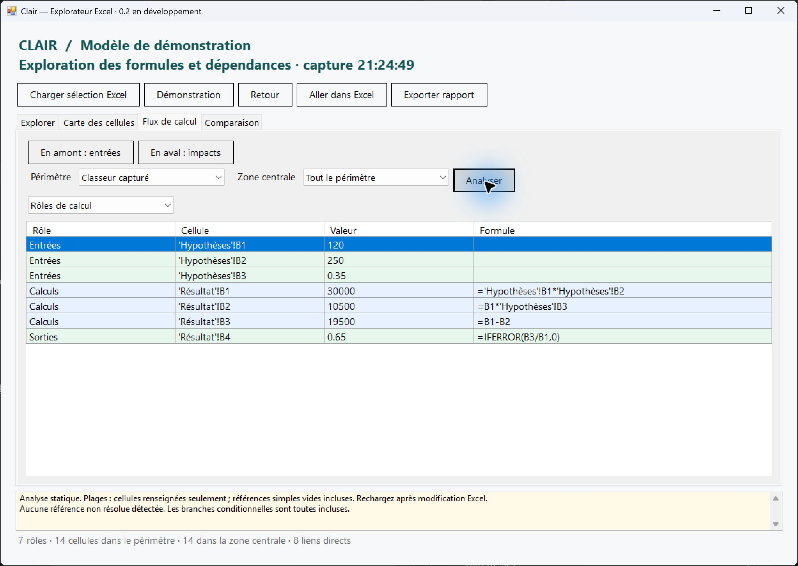

# Clair — Explorateur Excel

Prototype Windows indépendant pour explorer les formules et les dépendances d'un classeur Excel. C# / .NET Framework 4.8, interface WinForms, licence MIT.


## État

La version 0.2 fournit une application autonome et un complément Excel avec ruban. La reconstruction reste en cours : l'identité fonctionnelle et visuelle avec Arixcel n'est pas établie. Le [registre de parité](docs/PARITY.md) décrit les exigences et les preuves manquantes. Aucun composant, code décompilé, visuel ou ressource Arixcel n'est distribué avec le projet.

Le chargement COM, le callback du ruban, l'ouverture de plusieurs explorateurs et leur fermeture sont validés localement dans Excel 16.0. Les autres versions et l'architecture 32 bits restent à tester.

## Fonctions disponibles

- Capture du classeur actif et de la cellule sélectionnée, avec lecture groupée des valeurs et formules.
- Arbre d'antécédents et de dépendants, entre feuilles, avec détection des cycles et historique de navigation.
- Décomposition syntaxique des formules en fonctions, arguments, opérateurs, références et matrices ; sélection de la portion de formule correspondante.
- Évaluation des sous-expressions par Excel dans le contexte de la cellule : fonctions anglaises indépendantes de la langue Windows, variables LET, noms relatifs, références structurées de la ligne courante. La sélection Excel est restaurée après calcul.
- Édition de formule par F2, annulation propre à Clair avec contrôle des modifications externes et restauration du format numérique si celui-ci n'a pas changé. Une édition dans un tableau ne se propage pas à sa colonne.
- Références A1 absolues/relatives, plages rectangulaires, lignes/colonnes entières, noms absolus, intersections de références directes et noms de feuilles contenant des apostrophes.
- Navigation vers une cellule dans Excel, sans modifier sa valeur ou son format.
- Carte des cellules sous forme de liste colorée : formules, nombres, textes, booléens, erreurs.
- Parcours transitif en amont et en aval d'une cellule.
- Analyse des rôles de calcul et des flux de frontière avec périmètre et zone centrale distincts : entrées, calculs, sorties, formules isolées et quatre rôles de frontière.
- Comparaison de deux captures : formules et constantes, ou valeurs calculées avec tolérance numérique absolue.
- Rapport texte local et démonstration intégrée sans Excel.

## Démarrage

Prérequis : Windows, .NET Framework 4.8, Excel de bureau pour la connexion aux classeurs. Aucun paquet NuGet ni SDK .NET supplémentaire n'est nécessaire pour la compilation sur un système disposant du compilateur .NET Framework.

Depuis PowerShell, dans le dossier du projet :

```powershell
.\build.ps1
.\bin\Clair.exe
```

L'application démarre avec un modèle de démonstration. Pour votre classeur :

1. Ouvrez Excel, le classeur et la cellule à explorer.
2. Dans Clair, cliquez sur **Charger sélection Excel**.
3. Dépliez l'arbre d'antécédents, ou choisissez **Dépendants**.
4. Double-cliquez sur un nœud pour naviguer vers Excel. **Explorer ce nœud** change la racine de l'analyse.
5. Rechargez la sélection après une modification du classeur : l'analyse utilise une capture, pas une synchronisation permanente.

À droite, dépliez les sous-expressions : leur sélection met en évidence le texte et lance leur évaluation dans Excel. Décochez **Évaluer à la sélection** pour travailler manuellement. **Modifier (F2)** ouvre l'éditeur ; **Appliquer** écrit dans le classeur. **Annuler édition** restaure les changements effectués dans cette fenêtre, tant que la cellule n'a pas été modifiée depuis.

Dans **Flux de calcul**, choisissez un périmètre, une zone centrale puis **Analyser**. Le périmètre classeur/feuille utilise les cellules capturées ; une sélection Excel inclut aussi ses cellules vides. Le menu des vues distingue rôles de calcul et flux traversant la zone centrale. Un avertissement de dépendance rend ces résultats partiels.



Pour ajouter le ruban à Excel :

```powershell
.\install-addin.ps1
# Ouvrir ensuite une nouvelle instance d'Excel.
# Pour désinstaller : .\install-addin.ps1 -Uninstall
```

Le ruban ouvre plusieurs explorateurs indépendants ; **Tout fermer** les ferme ensemble. L'installation concerne le compte Windows courant et conserve le chemin de ce dossier : ne le déplacez pas sans réinstaller.

Pour comparer : chargez le premier état, ouvrez **Comparaison**, puis **Mémoriser référence**. Modifiez le classeur ou activez un autre classeur dans Excel, puis cliquez sur **Comparer classeur Excel actif**. Les cellules sont appariées par nom de feuille et adresse. En mode formules, un changement de résultat calculé seul n'est pas une différence ; activez **Valeurs calculées** pour le comparer.

Si plusieurs instances Excel sont ouvertes, la connexion autonome utilise celle exposée par `GetActiveObject`. Le nom du classeur capturé est affiché en haut. Les noms de classeurs non enregistrés ne constituent pas une identité durable entre plusieurs instances.

## Tests

```powershell
.\test.ps1          # moteur, syntaxe et flux (sans Excel)
.\test.ps1 -Excel   # sessions Excel isolées, expressions, édition et restauration
.\test-addin.ps1    # démarrage Excel /x, ruban, fenêtres, nettoyage registre
```

Le test Excel crée des instances et classeurs jetables, puis les ferme sans enregistrer. Il vérifie aussi les évaluations en français/anglais, les noms et tableaux, les sélections de plages/formes, l'édition, l'annulation, les conflits et les formats. Le test COM installe temporairement les clés propres à Clair, lance son propre processus Excel identifié, vérifie le chargement puis supprime les clés. Il refuse de remplacer une installation Clair existante.

## Limites explicites de la version 0.2

- Le graphe de cellules utilise toujours une extraction lexicale distincte du nouvel arbre syntaxique. Toutes les branches conditionnelles y sont considérées ; l'évaluation d'une expression ne corrige pas automatiquement ce graphe.
- `INDIRECT`, `OFFSET`, `LET`, `LAMBDA`, références externes, références 3D, tables structurées, noms relatifs et plages déversées signalés comme incomplets ou non résolus. Un avertissement signifie que le graphe peut manquer des cellules ou en inclure trop.
- Intersections directes de références prises en charge. Les intersections impliquant des noms ou expressions plus complexes nécessitent encore un analyseur syntaxique complet.
- L'arbre syntaxique prend en charge la notation A1 invariante. Notation R1C1, DDE et paramètres LAMBDA non liés ne sont pas évalués. Excel Evaluate limite l'expression contextualisée à 255 caractères ; les tableaux affichent un aperçu de 10 lignes × 5 colonnes, jusqu'à 8 zones. Les fonctions volatiles sont recalculées lors de l'évaluation.
- Édition des cellules fusionnées et matrices CSE refusée. Une formule déversée s'édite uniquement à son origine. L'annulation propre à Clair est limitée à la session de sa fenêtre ; l'historique natif d'Excel n'est pas préservé par les écritures COM.
- Les plages sont représentées par leurs cellules renseignées. Une référence simple vers une cellule vide reste visible ; les cellules vides d'une grande plage ne sont pas énumérées.
- Carte sous forme de liste, sans coloration du classeur original. Comparaison sans formats, alignement de lignes/colonnes ou renommage automatique des feuilles.
- Lecture des valeurs telles qu'Excel les expose. Mode de calcul manuel ou calcul en cours signalé ; aucune recalculation forcée.
- Lecture limitée à 250 000 cellules dans les zones utilisées. Arbre : 500 relations par nœud, profondeur 32. Flux : 2 000 cellules. Carte : 20 000 lignes. Limites signalées lors de leur atteinte.
- Capture et analyse synchrones ; de gros modèles peuvent bloquer temporairement l'interface.
- Windows/Excel uniquement. Chargement validé dans Excel local 16.0 ; couverture d'autres versions, architectures et déploiement signé encore manquante.

## Structure

`src/Core.cs` contient le modèle, la lecture lexicale des références, les parcours et la comparaison. `FormulaSyntax.cs` construit l'arbre d'expressions ; `FlowAnalysis.cs` classe les flux. `ExcelBridge.cs` et `ExcelOperations.cs` encapsulent les échanges COM. `MainForm.cs`, `ExpressionPanel.cs` et `FlowPanel.cs` fournissent l'interface. `AddIn.cs` expose le complément COM. Les tests se trouvent dans `tests/`.

Voir [analyse du logiciel de référence](docs/ANALYSIS.md), [revue et validation](docs/VALIDATION.md) et [prochaines étapes](docs/ROADMAP.md).

## Licence

[MIT](LICENSE). Arixcel et Microsoft Excel sont des produits distincts ; le projet n'est ni affilié ni approuvé par leurs éditeurs. La licence couvre uniquement les fichiers originaux de ce dépôt.
